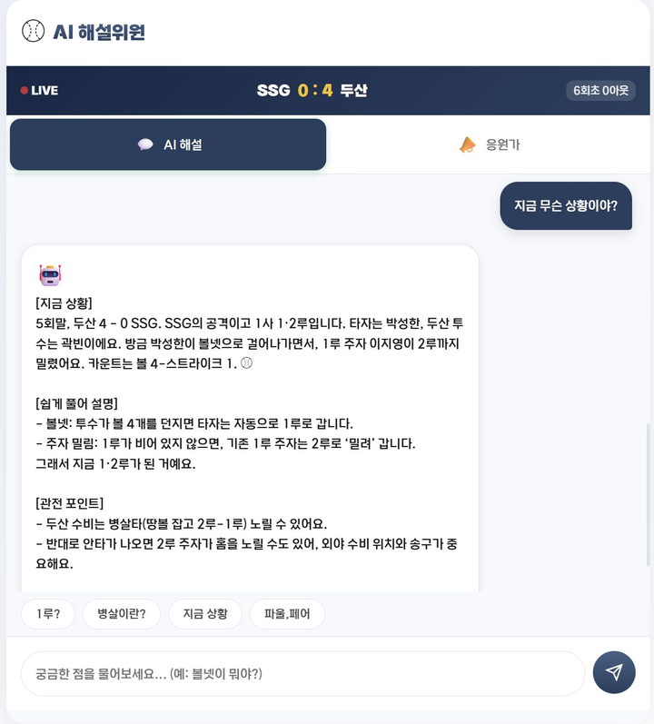
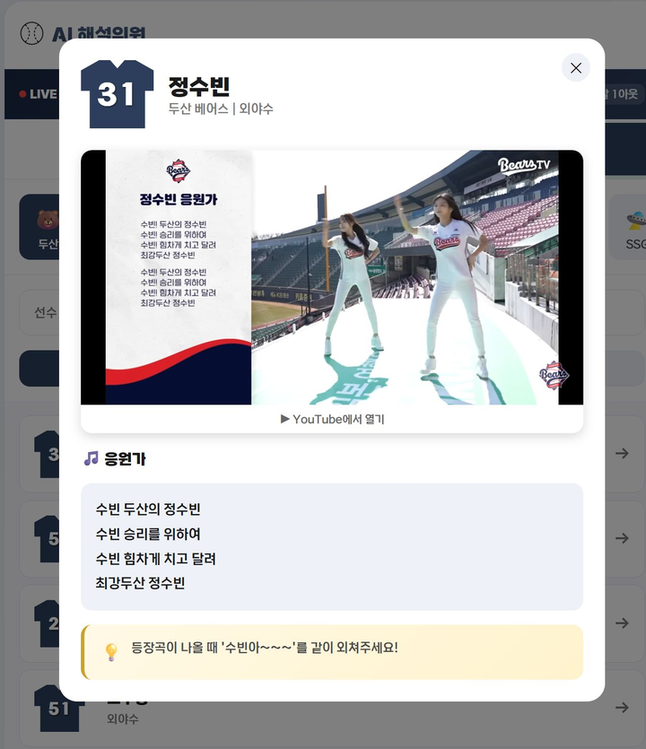
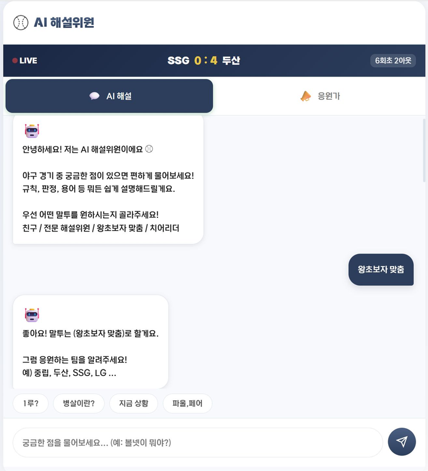
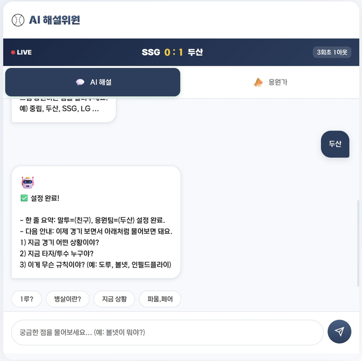
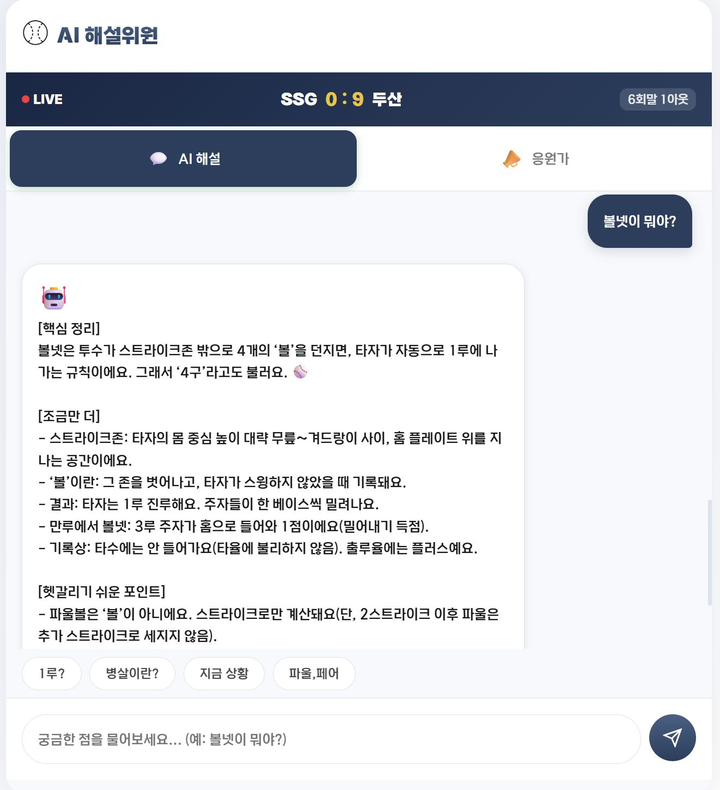
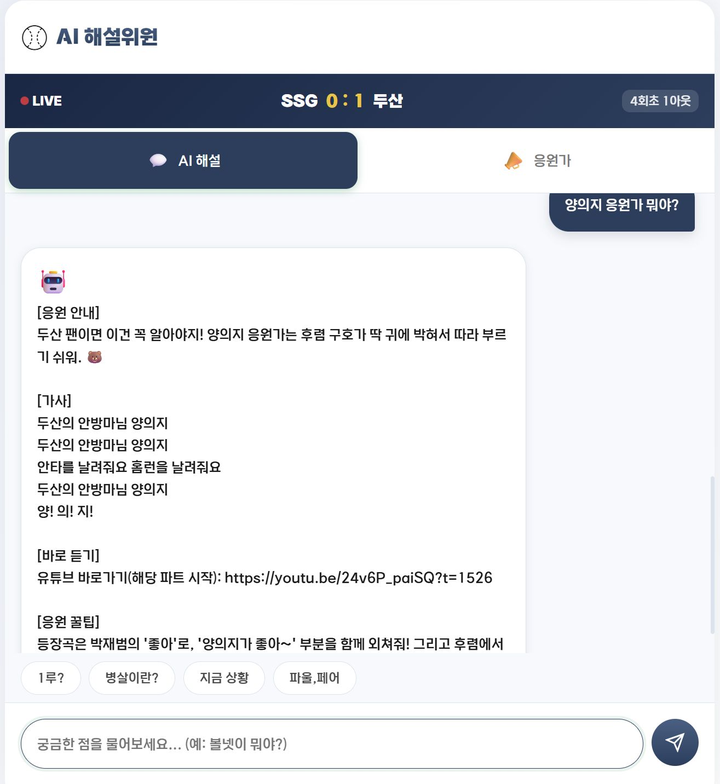
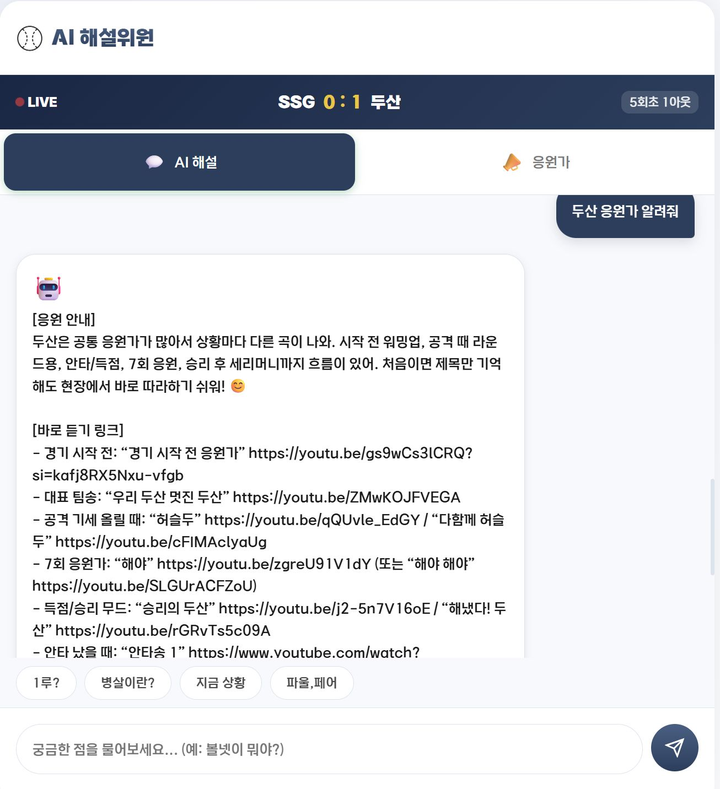
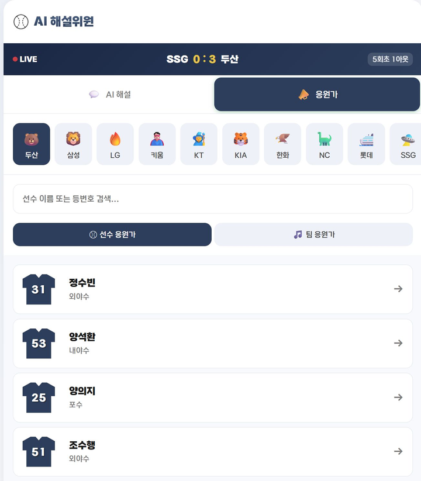
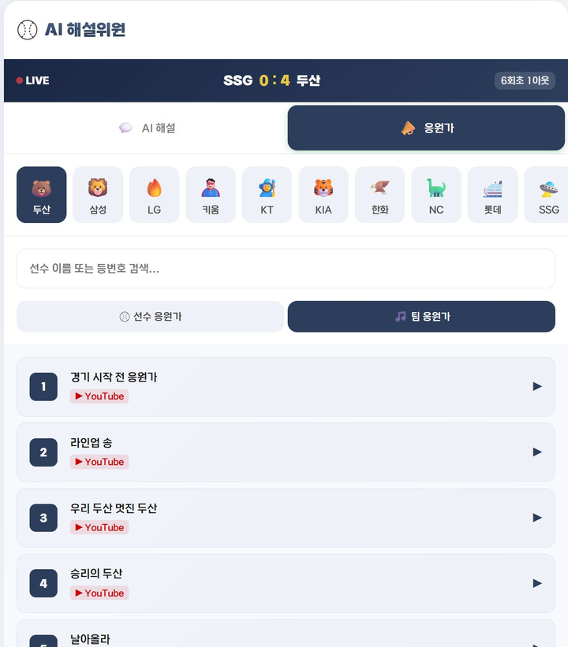
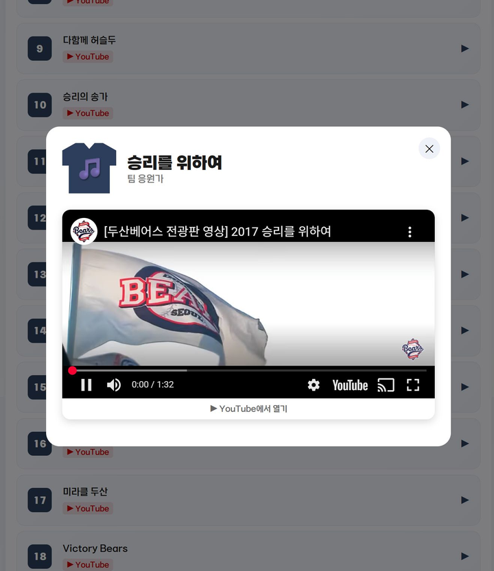

<div align="center">

# ⚾ AI 야구해설위원

### 야구 입문자를 위한 맞춤 해설, 실시간 경기 맥락 설명





</div>

---

## 🏆 수상

| | |
| --- | --- |
| **🏅 MVP READY상** | **2026 Big Data Promptthon** — 숙명여자대학교 빅데이터 혁신융합사업단 × (주)원티드랩 · 2026.02.07 · 팀 다 아라쓰<br>개발-테스트-보완 과정을 거쳐 **실제로 작동하는 수준의 우수한 결과물**을 구현한 팀에 수여 |

## 📌 프로젝트 정보

| | |
| --- | --- |
| **프로젝트명** | AI 야구해설위원 — KBO 입문자를 위한 맞춤 해설 · 실시간 경기 맥락 설명 서비스 |
| **행사** | **2026 Big Data Promptthon (원티드랩 프롬프톤)** — 숙명여자대학교 빅데이터 혁신융합사업단 × (주)원티드랩 |
| **팀** | 9팀 「다 아라쓰」 (숙명여자대학교 빅데이터 9조) |
| **기간** | 2026.01 ~ 2026.02 |
| **최종 발표** | **2026.02.07** |
| **발표자료** | [📄 presentation.pdf](docs/presentation.pdf) |
| **스택** | Wanted LaaS Preset(프롬프트) · FastAPI · SSE · Vanilla JS |

## 💡 문제 정의

야구 입문자는 경기를 보다가 **용어 혼란 → 상황 인식 실패 → 규칙 이해 실패 → 흥미 이탈**의 흐름을 겪습니다. (볼넷이 왜 1루 진루지? 병살이 뭐지?)

> *"우리는 야구 입문자가 상황과 규칙을 이해하지 못해 경기 관람을 즐기지 못하는 문제를,*
> *API 기반 상황 인지를 통한 입문자 맞춤형 실시간 해설 및 응원 가이드 서비스로 해결합니다."*

기존 서비스는 **규칙이 세세하고 복잡해** 입문자에게 와닿지 않고, 일반 LLM은 KBO/MLB 규정을 혼동하거나 **환각(hallucination)** 을 일으키기 쉽습니다. 그래서 **LLM 혼자 답하게 두지 않고, 경기 상태·규정·응원가를 API로 먼저 조회해 근거를 주입**하는 구조로 만들었습니다.

## ✨ 주요 기능

### 1. 페르소나 온보딩 — 말투와 응원팀을 고르면 그에 맞춰 답해요
`친구` / `해설위원` / `초보자` / `응원단` 중 말투를 고르고 응원팀을 입력하면, 이후 모든 답변이 그 설정(`tone`, `fan_team`)으로 생성됩니다.

<div align="center">


</div>

### 2. 실시간 상황 맞춤 해설 · 야구 규칙 질문
스코어보드(LIVE)에 보이는 **현재 경기 상태를 바탕으로** "지금 무슨 상황이야?"에 답하고, "볼넷이 뭐야?" 같은 규칙 질문은 **규정 검색 API 결과**를 근거로 [핵심 정리 / 쉽게 풀어 설명 / 현장 팁] 형태로 설명합니다.

<div align="center">


</div>

### 3. 채팅 속 응원가 안내
선수/팀 응원가를 물어보면 **응원가 DB**의 가사·응원 팁·유튜브 링크를 그대로 안내합니다. (DB에 없으면 임의로 지어내지 않는 fallback 처리)

<div align="center">


</div>

### 4. 응원가 탭 — 10개 구단 선수·팀 응원가
구단 선택 → 선수/등번호 검색 → 가사, 응원 팁, 유튜브 영상까지 한 번에.

<div align="center">




</div>

## 🏗 아키텍처

```
┌──────────────┐  params(tone, fan_team) + messages  ┌────────────────────┐        ┌──────────────────┐
│   Web UI     │ ──────────────────────────────────▶ │ FastAPI            │ ─────▶ │ Wanted LaaS      │
│ (Vanilla JS) │ ◀────────────────────────────────── │ /api/proxy/chat    │ ◀───── │ Preset (Prompt)  │
└──────┬───────┘                                     └─────────┬──────────┘        └──────────────────┘
       │  경기 요약 / 리플레이(SSE)                              │ 규정 · 응원가 · 선수 · 경기 상태 API
       └───────────────────────────────────────────────────────┘      (data/raw, data/processed)
```

- **API 중심 설계** — 프리셋이 호출하는 도구 성격의 API를 분리했습니다: 온필드 / 매치업 / 경기 라인업 / 야구 규정 검색 / 선수 응원가 / 팀 응원가 / 최근 이벤트 / 상황 요약 / 현재 상태.
- **키 노출 방지** — 브라우저는 LaaS를 직접 호출하지 않고 FastAPI 프록시만 호출합니다. API Key는 환경변수로만 관리합니다.

## 🔧 시행착오 & 개선

| 문제 | 해결 |
| --- | --- |
| **비시즌**이라 실시간 중계 데이터를 얻을 수 없음 | 과거 경기(2025.09.22 등) 이닝별 relay json을 수집하고, 이벤트를 시간순으로 재생하는 **리플레이 서버(SSE)** 구현 |
| LLM이 복잡한 규정을 **환각/왜곡** | 규정 데이터 구조화 + 규정 검색 API + fallback 응답 |
| 응원가 공식 DB 부재 | 선수/팀 응원가 DB를 직접 구축하고, DB에 없을 땐 지어내지 않도록 fallback 프롬프트 설계 |
| 현재 상황을 정확히 인지하지 못함 | 상황 요약 · 현재 상태 · 최근 이벤트 API를 추가해 프리셋에 주입 |
| 로컬 환경에서만 동작 | Vercel(프론트) / Railway(백엔드) 등 배포 구조 개선 방향 정리 |

## 📁 폴더 구조

```
.
├── index.html, css/, js/          # 프론트엔드 (Vanilla JS)
│   ├── chat.js                    #   온보딩 + 챗봇 UI → FastAPI 프록시 호출
│   ├── live.js, field_renderer.js #   리플레이 상태 조회 / 필드 렌더링
│   └── app.js, data.js            #   탭, 응원가 UI
├── player.json, team_chants.json  # 프론트에서 읽는 선수/팀 응원가 데이터
├── project/                       # 백엔드 (FastAPI)
│   ├── main.py                    #   규정·응원가·선수 API, 리플레이(SSE), LaaS 프록시
│   ├── collect_relay_innings.py   #   중계 데이터 수집 스크립트
│   └── data/                      #   raw(중계 json), processed(규정·응원가 요약)
├── notebooks/                     # 규정 ↔ 중계 이벤트 매핑 노트북 및 CSV
├── docs/screenshots/              # 서비스 화면
├── docs/presentation.pdf          # 최종 발표자료
└── 실행가이드_LaaS_웹이전.txt       # 상세 실행/트러블슈팅 가이드
```

## 🚀 실행 방법

Python 3.10+ 권장.

```powershell
pip install -r requirements.txt
```

**1. 환경변수 설정** (서버를 실행할 같은 터미널에서)

```powershell
$env:WANTED_LAAS_API_KEY="<발급받은 키>"
$env:WANTED_LAAS_PROJECT_ID="<프로젝트 ID>"
$env:WANTED_LAAS_PRESET_HASH="<프리셋 해시>"
```

**2. 백엔드 실행**

```powershell
cd project
uvicorn main:app --reload --port 8000
```

API 문서: http://127.0.0.1:8000/docs

**3. 프론트엔드 실행** — 저장소 루트에서 5500 포트로 정적 서버를 띄웁니다. (CORS 허용 오리진이 `localhost:5500`)

```powershell
python -m http.server 5500
```

브라우저에서 http://localhost:5500 접속.

> LaaS 환경변수 없이도 응원가 탭과 리플레이는 동작하고, 챗봇 호출만 500 오류가 납니다.

## 🔌 주요 API

| 경로 | 설명 |
| --- | --- |
| `GET /rules`, `/rules/search` | KBO 규정 조회/검색 |
| `GET /cheers`, `/players` | 응원가 / 선수 조회·검색 |
| `GET /games/{id}/summary`, `/commentary` | 경기 요약 / 해설 문장 |
| `GET /games/{id}/state`, `/lineup`, `/matchup`, `/onfield` | 현재 상태 / 라인업 / 매치업 / 필드 |
| `POST /games/{id}/replay/start` | 리플레이 시작 (pause / seek / reset 포함) |
| `GET /games/{id}/stream` | SSE 실시간 스트림 |
| `POST /api/proxy/chat` | LaaS 프리셋 프록시 |

## ⚠️ 데이터 출처 및 유의사항

- 경기 중계 데이터는 네이버 스포츠 중계 응답을 학습/시연 목적으로 수집한 것입니다. 상업적 이용은 별도 확인이 필요합니다.
- 서체 `KBO-Dia-Gothic`의 저작권은 KBO에 있으며, 해당 서체의 이용 조건을 따릅니다.
- 선수/응원가 정보는 공개 자료를 정리한 것으로 부정확한 부분이 있을 수 있습니다.
- 화면 속 경기(SSG vs 두산)는 과거 경기 데이터를 리플레이한 것입니다.

## 👥 팀

**9팀 다 아라쓰** — 숙명여자대학교 빅데이터 9조

| 이름 | 담당 |
| --- | --- |
| **이유진** | 프롬프트 설계 · 발표자료 제작 (PM / 서비스 기획) |
| **송은지** | 데이터 전처리 · 웹 서비스 구현 |
| **사공건** | 규정집 · 응원가 데이터 구축 |
| **정채연** | API 개발 · 연동 및 배포 |
